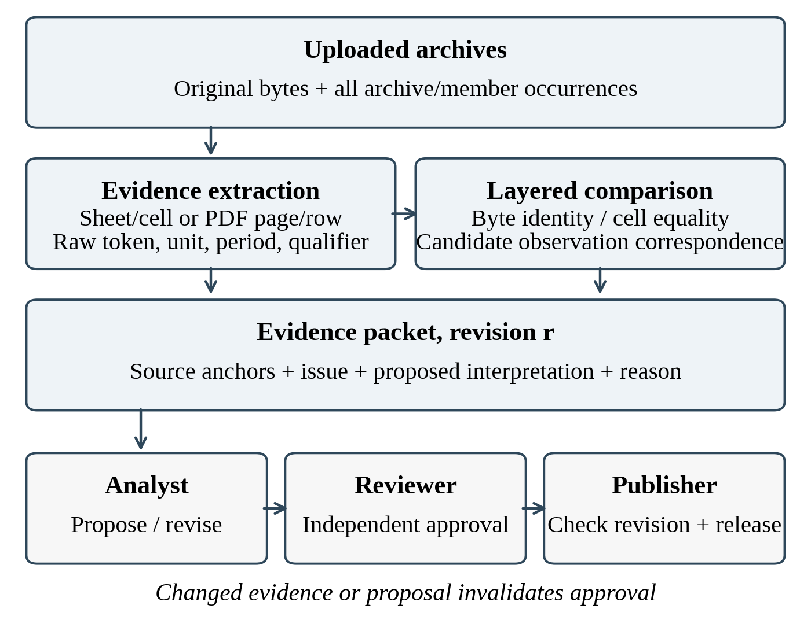
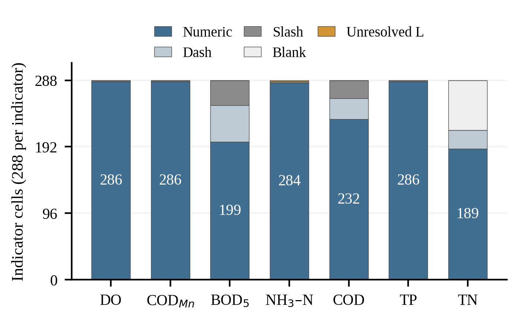

# Source-Preserving Reconciliation for Collaborative Water-Quality Review

Zehan Zhang  
Hohai University, China  
3993472947@qq.com

## Abstract

Collaborative water-quality review requires participants to distinguish repeated reports from independent evidence and to inspect unresolved interpretations before publication. We present a source-preserving research pipeline that separates archive occurrences, file contents, table anchors, and candidate observation correspondences. Raw tokens, reporting-period evidence, units, and qualifiers remain attached to derived records. Review packets bind a proposed decision to its evidence; independent approval becomes invalid when that proposal or evidence changes. Evaluation uses two supplied water-quality archives from Xinwu District, Wuxi. Their 91 file occurrences contain 68 byte-distinct payloads, including three further workbook pairs with identical cell values despite different bytes. A three-year priority-section stratum contains 2,016 indicator cells, of which 252 are missing and two have unexplained qualifiers. A separate twelve-month panel contains 1,524 report-section-month rows. The pipeline generates 31 unresolved evidence packets, and all 9,395 primary spreadsheet anchors match their source cells after one extraction defect is corrected. Naturally observed month conflicts and station-label variants remain explicit review cases rather than automatic corrections. Fifteen scripted workflow scenarios pass, including stale-approval and self-review rejection. The results establish technical traceability and functional review constraints for this case; they do not measure expert decision accuracy or human review efficiency.

**Keywords:** Collaborative review, Data provenance, Water quality, Evidence reconciliation, Human-in-the-loop systems

## I. Introduction

River-water quality review is a collaborative information task as well as an environmental assessment task. An analyst may receive a monthly spreadsheet, an annual summary, and a later archive containing copies of earlier reports. A reviewer must establish which source supports a value, whether apparently repeated records describe the same measurement, and whether a proposed correction is justified. A consolidated table alone does not communicate these distinctions. Replacing an old value with a new one can remove precisely the evidence that another participant needs to assess the decision.

The supplied Xinwu District, Wuxi, archives expose this problem in ordinary reporting material. They mix spreadsheet and portable-document formats, monthly and cumulative statistics, different monitoring programs, and a three-year priority-section workbook. Repetition occurs both as identical files and as workbooks with identical cell contents but different bytes. Other ambiguities involve reporting months, station labels, missing-value tokens, and two unexplained numeric qualifiers. Treating every file as independent inflates the evidence base; treating every station-month match as a duplicate can erase legitimate distinctions between programs.

Provenance models describe how entities are derived through activities and agents [1], [2]. Interactive cleaning tools make transformations inspectable [3], while probabilistic repair and human-in-the-loop work address how cleaning decisions are proposed and assessed [4], [5]. Our concern is the boundary between automated reconciliation and a shared review decision when the source does not establish an authoritative answer. The research question is: how can a computational workbench reduce redundant evidence while keeping unresolved interpretations available to an independent reviewer?

We contribute a source-preserving evidence representation, a conservative reconciliation pipeline, and a revision-bound review protocol. The representation separates archive occurrences, file contents, table locations, and candidate observation correspondences. The pipeline preserves raw tokens and generates review packets instead of silently repairing ambiguous records. The protocol binds approval to the current proposal and evidence, preventing an earlier approval from authorizing a changed result. We evaluate the implemented research sidecar on the supplied archives and scripted workflow scenarios. We report technical traceability and ambiguity counts, without claiming expert accuracy, human efficiency gains, or a validated water-quality forecasting model.

## II. Related Work

The W3C provenance family provides a vocabulary for entities, activities, and responsible agents [1], [2]. These concepts help separate an uploaded report from a derived interpretation and the person approving it. They do not, by themselves, specify spreadsheet duplicate semantics or a publication gate. We adopt this separation conceptually; the implementation exports structured evidence and event records rather than claiming a complete ontology serialization.

Wrangler supports interactive specification of data transformations [3]. HoloClean formulates data repair using probabilistic inference [4], whereas work on reliable interactive cleaning emphasizes the role of user interaction and system recommendations [5]. Our prototype complements these directions by retaining an explicit unresolved outcome. A plausible station-name correction or qualifier interpretation is insufficient grounds to replace a source token. Automated repair quality is outside the evaluation because no independently adjudicated repair labels are available.

Provenance is also studied in collaborative systems. BMDP considers multi-cloud storage provenance [6], and VGAE4PG addresses provenance graph reduction [7]. Our problem concerns application-level evidence equivalence and review state, rather than cloud storage or learned graph reduction. Role-based access control supplies a well-established basis for assigning operations to roles [8]. The additional application rule here is that an approval must refer to a specific evidence fingerprint and proposal revision; a role assignment alone cannot make stale approval valid.

## III. Evidence and Review Method

### A. Distinct Levels of Identity

An archive occurrence is identified by its archive-manifest identifier and member path. A file-content entity is identified by a SHA-256 digest of its original bytes. A source anchor adds a worksheet, Excel row and column, or a portable-document page, table sequence, and indicator column. A parsed indicator cell retains this anchor alongside the original river and station labels, period evidence, monitoring program, statistic scope, indicator, unit, raw token, typed value, and quality flags. Multiple archive occurrences may point to one file-content entity. This avoids storing repeated payloads without discarding where each copy was supplied.

The typed value is numeric, missing with its original token class, explicitly censored, or unresolved. A slash, dash, and blank remain distinguishable missing states. Zero remains a reported numeric value. The strings 0.025L and 0.03L are unresolved because no explanatory legend was found; the pipeline neither strips L nor substitutes a detection-limit estimate. Reporting month and sampling date are separate fields. An Excel first-of-month value in the priority workbook denotes a statistical month, not an observed sampling instant.

Byte identity establishes repeated file content. For matching relative-path workbooks with different byte hashes, a separate comparison checks all sheets and cell values, including blanks. Cell equality is reported without claiming identical formatting, formulas, or complete file semantics. Neither level establishes that equal measurements in different reports originate from the same physical sample. Original files and occurrence links are retained under all consolidation operations.

Fig. 1. Research-sidecar pipeline. Review decisions are separate from source evidence; changed proposals or evidence require renewed approval.

### B. Conservative Correspondence and Issue Packets

Names are normalized only by Unicode normalization and surrounding whitespace removal. Bridge suffixes, route numbers, and other distinguishing characters are preserved. Program, period scope, reporting month, station, indicator, and unit form part of a report-level comparison signature. Raw tokens, typed values, reported target, and quality grade remain attached, preventing a numeric match from hiding a metadata change. Annual cumulative reports are excluded from the monthly panel rather than pooled with monthly observations.

A broader candidate join uses exact normalized station label, statistical month, and indicator across reporting programs, with matching reported units. This join produces a review opportunity, not an equivalence assertion. Numeric agreement is exact equality of canonical decimal representations of extracted numeric values; no tolerance is selected after seeing the results. A disagreement indicates different reported numbers, not an error in either source. Different sample dates, methods, aggregation rules, or program definitions can explain it. Non-numeric cells are reported separately. Flagged month conflicts retain a provisional month for candidate retrieval and remain explicit issues; a retrieved pair does not establish a resolved reporting period. The five shared indicators in this selected comparison all have matching milligram-per-litre units.

Issue detectors expose evidence already present in the files. A path/title month contradiction creates a temporal packet. Consecutive label variants within the same source row-position block create an entity-review packet, without assigning an external canonical station. Qualified values create an interpretation packet. Each initial packet contains the issue, relevant source anchors, raw and parsed fields, a rationale, and an unresolved disposition. Its anchors link to supplied copies through the occurrence manifest. An analyst may subsequently attach a proposed action and reason. The output supports decisions such as retain separately or request clarification; it need not force a corrected value.

Hash indexing and evidence grouping require expected O(n + l) work for n records and l occurrence links. An indexed candidate join requires O(n + c) work, where c is the emitted candidate-pair count. This is an output-sensitive description, not a scalability benchmark. A content digest identifies evidence but does not establish its scientific correctness.

### C. Revision-Bound Collaborative Review

The reference protocol implements open, proposed, approved, rejected, and published states. Analysts or editors create a packet and submit a proposal with a nonempty reason. A reviewer must be a different actor from both creator and proposer. An approval stores the proposal revision, decision digest, and a fingerprint over the referenced evidence. Any revised proposal clears prior approval. Publication requires an approved current revision, an unchanged decision and evidence fingerprint, and a publisher role held by someone other than the creator or proposer. A reviewer with a publisher role may publish; a third distinct person is not universally required.

Evidence registration is append-only through the public interface, and returned objects are copies. An ordered, hash-linked event log records allowed and denied operations. Comparing its head with a retained checkpoint reveals tested modifications to recorded events. This is tamper evidence under an unchanged checkpoint, not an immutable or signed distributed ledger. Actor identities are supplied by a trusted caller; identity authentication, hostile storage access, and organizational deployment are outside this prototype.

## IV. Case Data and Evaluation Protocol

### A. Corpus and Analysis Scope

The case material consists of two user-supplied archives concerning Xinwu District water quality. Public use was authorized by the data provider. The complete file inventory contains 91 occurrences: 26 in the 2024 package and 65 in the multi-year package. All 26 members of the 2024 package also occur in the other package. Twenty-three pairs are byte-identical; three corresponding workbooks differ in bytes but have no cell-value differences in the all-sheet comparison. The inventory therefore contains 68 byte-distinct payloads. These counts describe supplied files, not independent measurements or spatial monitoring sites. The accompanying artifact records input digests, extraction rules, normalized tables, issue packets, and scenario results; the selected strata do not exhaust every report in the archives.

The first analysis stratum is the priority-section workbook for 2022–2024. Of 360 numbered rows, 72 are annual or year-over-year summaries and are excluded from the monthly stratum. The remaining 288 rows represent eight recurring source row-position blocks over 36 statistical months. Seven indicators yield 2,016 indicator cells, with concentration units reported as milligrams per litre. Twelve distinct river/station label pairs occur, but the number of externally verified physical stations is unknown. A row-position block is not used as proof of station identity. The indicators are dissolved oxygen (DO), permanganate index (CODMn), five-day biochemical oxygen demand (BOD5), ammonia nitrogen (NH3N), chemical oxygen demand (COD), total phosphorus (TP), and total nitrogen (TN).

The second stratum uses the 2024 package as the representative monthly reporting panel. It includes 38 Xinwu rows from the 552 program and 89 from the 598 program per month: 1,524 report-section-month rows across twelve months and 8,370 indicator cells. January is extracted from the two portable-document reports; February–December use spreadsheets. Citywide tables are filtered to the explicitly labelled Xinwu district. The 89 January 598 sections correspond to 79 distinct river names. Fifteen river names overlap the two January programs, giving 102 names in their union; neither the archive title nor a river-name count establishes independent samples. Annual reports and alternative byte versions remain available for auditing but are not appended to this monthly panel.

**TABLE I. DISTINCT DENOMINATORS IN THE CASE STUDY**

| Scope | Unit | Count |
| --- | --- | --- |
| Both archives | File occurrences / byte payloads | 91 / 68 |
| Repeated 2024 package | Byte-identical / cell-equal pairs | 23 / 3 |
| Priority workbook | Monthly rows / indicator cells | 288 / 2,016 |
| 2024 monthly panel | Report rows / indicator cells | 1,524 / 8,370 |
| Priority exclusions | Annual or comparison rows | 72 |

### B. Reproducible Tasks and Comparators

We evaluate four technical tasks: inventory consolidation, typed-value preservation, cross-program correspondence inspection, and review-protocol behavior. Append-all provides the raw file-occurrence baseline. A stronger hash-plus-manifest comparator consolidates byte-identical payloads while retaining every occurrence link. The proposed pipeline adds cell-value comparison, typed evidence, issue packets, and revision-bound review. We do not attribute loss of provenance to the stronger comparator: retaining its manifest already preserves supplied-file aliases. The comparison isolates the extra distinctions that whole-file hashes cannot express.

All 9,395 primary spreadsheet indicator anchors are checked against their source workbooks for token identity or exact numeric equivalence in the evaluation script; selected issue cases are inspected using their exact anchors. January portable-document records retain page and table-sequence anchors, which are not Excel cell coordinates. The workflow evaluation consists of 15 scripted functional scenarios with expected allowed and denied transitions. No scenario is a human participant, and no timing, usability, or expert-decision benchmark is inferred from these tests. There is no training/test split or forecasting model; duplicate files are not counted as predictive samples.

## V. Results

### A. Duplication and Evidence Preservation

Compared with append-all, the hash-plus-manifest comparator reduces stored file payloads from 91 to 68 while retaining all 91 occurrence links. This removes 23 repeated payload copies, or 25.3% of the occurrence count. The three additional same-path workbook pairs have zero differing cell values despite different byte digests. They illustrate why file hashes alone cannot characterize report-content repetition. Their original bytes remain retained; the pipeline records the cell-equality relation instead of claiming full semantic equivalence or silently deleting a version.

The priority stratum contains 1,762 numeric cells, 252 missing cells, and two unresolved L-qualified cells. Missing cells comprise 110 dashes, 70 slashes, and 72 blanks. Consequently, 254 cells, or 12.6%, cannot be treated as ordinary measured numbers. Figure 2 shows that this burden is concentrated in biochemical oxygen demand, chemical oxygen demand, and total nitrogen rather than uniformly distributed. A complete-case or zero-fill transformation would change the usable evidence population; the proposed representation retains the reason each cell is unavailable for numeric comparison.

Fig. 2. Raw value states in the 2,016-cell priority stratum. Missing-token classes and unexplained L qualifiers remain explicit; numeric counts are shown inside bars.

### B. Naturally Observed Review Cases

The May 598 spreadsheet has a May filename and archive location but an internal April title. The pipeline preserves both assertions, flags the nominal May as provisional, and makes no authoritative month correction. In the March 552 table, the raw month field states 12 while dated rows and surrounding reporting context indicate March. This is presented as conflicting temporal evidence rather than an automatically repaired date. Neither discrepancy establishes which source field the provider intended.

Within the priority workbook, one continuous Wangyu River row-position block changes from a route-312 bridge label to route-313/314/315 variants in the final months of 2022 and to route-313/314 variants in the final months of 2024. There are six variant monthly rows. Repetition within a block makes these useful review candidates, but does not prove that the variants are typographic mistakes. The two L-qualified ammonia-nitrogen entries similarly remain interpretation requests. Source values are not replaced by the dominant name or by a guessed quantification limit.

Across the selected strata, 10,386 primary indicator cells comprise 9,715 numeric values, 668 missing values, two unresolved qualifiers, and one source-cell error. Source verification identified an extraction failure in the March 552 workbook: Excel cell P500 contains #REF!, which the initial dataframe reader represented as a blank. Preserving the workbook error token corrected its status to source-cell error. After correction, all 9,395 primary spreadsheet anchors match the original cells. The 991 selected portable-document cells have page, table-sequence, and indicator-column anchors; this structural completeness is not an independently measured optical-recognition accuracy.

The cross-program join produces 57 station-month candidate groups and 285 indicator pairs. All 272 pairs with numeric values on both sides are exactly equal; the remaining 13 are not jointly numeric. There are no observed numeric disagreements in this candidate set. Agreement can reflect common reporting inputs and cannot establish independent monitoring validation. Sixty indicator pairs also carry different river-name strings despite an exact station-label match. No candidate pair is automatically merged into a physical-sample identity. Excluding all candidates with period-quality flags leaves 260 pairs in 52 groups: 248 equal numeric pairs and 12 not jointly numeric, again with no numeric disagreements. Thus the primary result includes 25 provisional-period pairs rather than silently treating them as resolved observations.

The pipeline emits 31 review packets across the selected evidence and file-version audit. These comprise one source-cell error, two qualifier cases, two within-year station-label cases, one between-year label case, two target-context changes, two period disagreements, three byte-distinct/cell-equal workbook cases, and 18 cross-program cases requiring contextual review. A packet may contain multiple cells or rows, so these counts are not error prevalence. All 31 remain open: no expert proposals, approvals, or publications are fabricated.

**TABLE II. SELECTED EVIDENCE REPRESENTATION COMPARISON**

| Representation | Records | Occurrence links | Review packets |
| --- | --- | --- | --- |
| Append all occurrences | 18,756 | 18,756 | 0 |
| Hash + alias manifest | 10,576 | 18,756 | 0 |
| Exact key, one representative | 10,386 | 10,386 | 0 |
| Exact key + alias manifest | 10,386 | 18,756 | 0 |
| Proposed review sidecar | 10,386 | 18,756 | 31 |

Table II includes 190 indicator cells from the alternative February workbook version in addition to the 10,386 primary cells. Materializing every archive occurrence yields 18,756 cell links. Both exact-key methods reduce the content-level records to 10,386 report-level assertions. The stronger exact-key-plus-manifest comparator preserves the same links as the sidecar; the contribution is not a further compression gain. It is the explicit interpretation states, evidence packets, and revision-bound review decisions added to that representation. A representative-only output loses 8,370 occurrence links in this case, whereas retaining an alias manifest avoids that loss.

### C. Review-Protocol Checks

All 15 scripted protocol scenarios pass, covering 59 transition attempts: 45 allowed and 14 denied. Denied attempts include missing-role actions, self-review after a role change, premature publication, publication following rejection, and use of approval after a revised proposal or evidence change. The scenarios also check copied return objects, evidence tampering, modified audit events, and terminal publication state. These results support the implemented transition contract under the tested caller model. They are not evidence of authenticated multi-organization security, formal verification, or improved reviewer performance.

## VI. Discussion and Conclusion

The case shows why collaborative review benefits from separating repetition from agreement. A repeated file can be consolidated without a scientific decision. Equal cells in different byte versions justify a narrower relation. Matching station-month values across programs justify only a correspondence candidate until the sampling and aggregation basis is established. Missing tokens and unexplained qualifiers require interpretation, and a reviewer should see the original evidence for that interpretation. The useful output is therefore a traceable decision boundary as well as a consolidated table.

The implemented pipeline is a research sidecar to an existing water-network workbench. The workbench provides roles, document retrieval, and a three-dimensional interface, but native chemical-observation ingestion and the new protocol are not claimed as deployed platform services. No language model is configured or evaluated for water-quality reasoning. Spatial stations in the workbench have not been authoritatively linked to the report sections. These boundaries prevent interface capabilities from being mistaken for validated environmental models.

Limitations include one district, a finite set of table layouts, incomplete reporting semantics, and the absence of an independently adjudicated station-alias or repair gold standard. Exact decimal agreement may miss equivalent rounded reports; relaxed matching could instead create false correspondences. Spreadsheet cell equality does not inspect every formatting or calculation property. Portable-document extraction has different anchoring guarantees. Future work should evaluate expert-adjudicated packets, task completion and review workload, broader report layouts, authenticated deployment, and integration with the workbench. Tide-resolved transport or causal water-quality prediction would require additional measurements and calibrated models.

We presented an implemented method for preserving source evidence through report consolidation, conservative correspondence, and revision-bound collaborative review. The Xinwu case demonstrates substantial archive repetition and actionable ambiguities while keeping unresolved questions explicit. The contribution is an auditable basis for shared review; establishing scientific corrections remains a separate expert responsibility.

## Acknowledgments

No external funding supported this work. OpenAI ChatGPT/Codex assisted the drafting of Sections I–VI and preparation of the analysis, validation, and figure-generation code.

## References

[1] P. Missier, K. Belhajjame, and J. Cheney, “The W3C PROV family of specifications for modelling provenance metadata,” in Proc. 16th Int. Conf. Extending Database Technology, 2013, pp. 773–776, doi: 10.1145/2452376.2452478.

[2] T. Lebo, S. Sahoo, and D. McGuinness, Eds., “PROV-O: The PROV Ontology,” W3C Recommendation, Apr. 30, 2013. [Online]. Available: https://www.w3.org/TR/prov-o/

[3] S. Kandel, A. Paepcke, J. Hellerstein, and J. Heer, “Wrangler: Interactive visual specification of data transformation scripts,” in Proc. SIGCHI Conf. Human Factors in Computing Systems, 2011, pp. 3363–3372, doi: 10.1145/1978942.1979444.

[4] T. Rekatsinas, X. Chu, I. F. Ilyas, and C. Ré, “HoloClean,” Proc. VLDB Endowment, vol. 10, no. 11, pp. 1190–1201, 2017, doi: 10.14778/3137628.3137631.

[5] S. Krishnan, D. Haas, M. J. Franklin, and E. Wu, “Towards reliable interactive data cleaning: A user survey and recommendations,” in Proc. Workshop on Human-In-the-Loop Data Analytics, 2016, pp. 1–5, doi: 10.1145/2939502.2939511.

[6] F. Wang, J.-T. Zhou, and X. Guo, “BMDP: Blockchain-based multi-cloud storage data provenance,” in Proc. 26th Int. Conf. Computer Supported Cooperative Work in Design, 2023, pp. 703–708, doi: 10.1109/CSCWD57460.2023.10152006.

[7] A. Lv, G. Ouyang, and Y. Huang, “VGAE4PG: A semantically preserved unsupervised provenance graph reduction framework,” in Proc. 29th Int. Conf. Computer Supported Cooperative Work in Design, 2026, pp. 947–956, doi: 10.1109/CSCWD68734.2026.11581538.

[8] R. S. Sandhu, E. J. Coyne, H. L. Feinstein, and C. E. Youman, “Role-based access control models,” Computer, vol. 29, no. 2, pp. 38–47, 1996, doi: 10.1109/2.485845.
